# Virtual Power Grid

This diagram represents the simplified power grid used in our micro-project. It contains one main power station, four city substations, four cities and shared infrastructure.

The diagram shows the logical connections between locations. It is a simulated model, not the exact electrical layout of a real city.

```mermaid
flowchart TB

    P[Main Power Station]

    P --> S1[City 1 Substation]
    P --> S2[City 2 Substation]
    P --> S3[City 3 Substation]
    P --> S4[City 4 Substation]

    subgraph CITY1[City 1]
        C1[City 1 Distribution]
        C1 --> H1[4 Houses]
        C1 --> HP1[Hospital]
        C1 --> PO1[Police Station]
        C1 --> FI1[Fire Station]
        C1 --> CL1[Clinic]
        C1 --> WT1[Water Treatment]
        C1 --> PU1[Schools and College]
        C1 --> BU1[Bus and Train Stations]
        C1 --> IN1[Industrial Park]
    end

    subgraph CITY2[City 2]
        C2[City 2 Distribution]
        C2 --> H2[4 Houses]
        C2 --> HP2[Hospital]
        C2 --> PO2[Police Station]
        C2 --> FI2[Fire Station]
        C2 --> CL2[Clinic]
        C2 --> WT2[Water Treatment]
        C2 --> PU2[Schools and College]
        C2 --> BU2[Bus and Train Stations]
        C2 --> IN2[Industrial Park]
    end

    subgraph CITY3[City 3]
        C3[City 3 Distribution]
        C3 --> H3[4 Houses]
        C3 --> HP3[Hospital]
        C3 --> PO3[Police Station]
        C3 --> FI3[Fire Station]
        C3 --> CL3[Clinic]
        C3 --> WT3[Water Treatment]
        C3 --> PU3[Schools and College]
        C3 --> BU3[Bus and Train Stations]
        C3 --> IN3[Industrial Park]
    end

    subgraph CITY4[City 4]
        C4[City 4 Distribution]
        C4 --> H4[4 Houses]
        C4 --> HP4[Hospital]
        C4 --> PO4[Police Station]
        C4 --> FI4[Fire Station]
        C4 --> CL4[Clinic]
        C4 --> WT4[Water Treatment]
        C4 --> PU4[Schools and College]
        C4 --> BU4[Bus and Train Stations]
        C4 --> IN4[Industrial Park]
    end

    S1 --> C1
    S2 --> C2
    S3 --> C3
    S4 --> C4

    P --> COMMON[Shared Infrastructure]
    COMMON --> AIR[Airport]
    COMMON --> WATER[Water Treatment Facility]
    COMMON --> WASTE[Waste Management]
```

