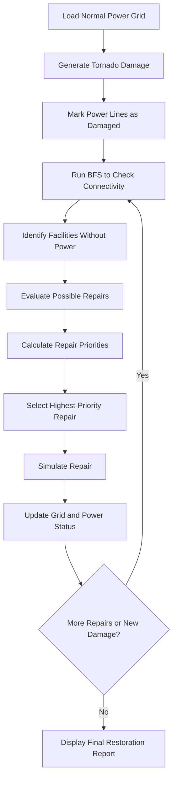

# Power Grid Restoration Workflow

This diagram shows the proposed workflow of our C++ decision-support system.

## Explanation

1. The program loads the normal power grid.
2. A tornado-damage scenario is generated.
3. Damaged lines are identified and recorded.
4. BFS determines which facilities remain connected to the power source.
5. The system evaluates repair options based on facility importance, repair time, repair effort and dependencies.
6. A priority queue selects the next recommended repair.
7. The grid is updated after the repair, and the analysis is repeated if needed.
8. The system displays a final restoration report.
